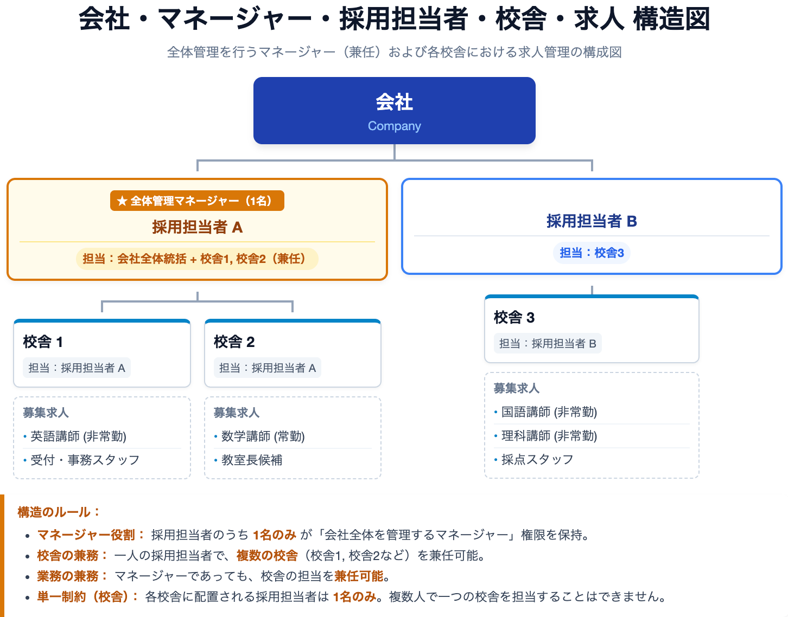

# 塾マッチ掲載企業向け利用ガイド

**最終更新**: 2026-07-27

## 前書き
- これは [塾講師マッチング: https://www.juku-match.jp](https://www.juku-match.jp) の掲載企業向け利用ガイドです。
- Chrome での利用を想定しており、ドキュメント内のスクリーンショットも Chrome のものとなっておりますが、他のブラウザでもほとんど同様にご利用いただけます。
- これは最終更新日時点のものであり、その後UIやシステムが更新される場合があります。
- 資料中の人名や会社名などについては、サンプルデータであり、実在するものとは関係ございません。

## 概要
利用ガイドの前に、塾マッチのシステムの構成に関して説明します。

塾マッチでは、次の図のように組織が構成されます。

- データの基本構造は **「会社」→「校舎」→「求人」** という形です。
- **マネージャー** は、会社全体の管理（校舎作成、担当者管理、会社情報更新など）を行います。
- **採用担当者** は、**割り当て** られた校舎の範囲で求人作成・応募対応などの実務を行います。

まずは **「マネージャーが会社全体を管理し、その配下で採用担当者が校舎ごとの採用業務を進める」** というイメージを持っていただくと、この後の章が読みやすくなります。

## 目次
1. マネージャー向け会社管理チュートリアルは [こちら](マネージャーチュートリアル.md)。  
    - 利用開始から校舎割り当てまで(+請求書) のステップを想定したチュートリアルです。  
2. 担当校舎管理チュートリアルは [こちら](校舎管理チュートリアル.md)。  
    - 招待を受け校舎を割り当てられてから求人掲載、採用プロセスまでを想定したチュートリアルです。  
3. 掲載企業向けのマニュアルは [こちら](./掲載企業向けマニュアル.md)。  
    - 各機能に関しての説明書です。部分的な機能を理解するのに適します。  
