# 掲載企業様向けマニュアル
**最終更新**: 2026-07-28

## 前書き
- これは [塾講師マッチング: https://www.juku-match.jp](https://www.juku-match.jp) の掲載企業向け利用ガイドです。
- Chrome での利用を想定しており、ドキュメント内のスクリーンショットも Chrome のものとなっておりますが、他のブラウザでもほとんど同様にご利用いただけます。
- これは最終更新日時点のものであり、その後UIやシステムが更新される場合があります。
- 資料中の人名や会社名などについては、サンプルデータであり、実在するものとは関係ございません。

## 概要
塾マッチでは、次の図のように組織が構成されます。

- データの基本構造は **「会社」→「校舎」→「求人」** という形です。
- **マネージャー** は、会社全体の管理（校舎作成、担当者管理、会社情報更新など）を行います。
- **採用担当者** は、**割り当て** られた校舎の範囲で求人作成・応募対応などの実務を行います。

まずは **「マネージャーが会社全体を管理し、その配下で採用担当者が校舎ごとの採用業務を進める」** というイメージを持っていただくと、この後の章が読みやすくなります。

- マネージャー向け校舎管理チュートリアル: (ただいま準備中です)。
- 担当校舎管理チュートリアル: (ただいま準備中です)。

## 目次
**サービス利用について**
1. [サービス利用開始の流れ＆マネージャー登録](#サービス利用開始の流れマネージャー登録)
1. [利用停止の流れ](#利用停止の流れ)
1. [採用担当者アカウント登録](#採用担当者アカウント登録)

**マネージャー含む全ての採用担当者に関する共通機能について**
1. [一般の採用担当者ができること](#一般の採用担当者ができること)
    1. [ログイン](#ログイン)
    1. [更新リクエスト履歴の確認](#更新リクエスト履歴の確認)
    1. [通知・メール(リクルーター)](#通知・メールリクルーター)
    1. [プロフィール設定](#プロフィール設定)
    1. [2段階認証設定(強く推奨)](#2段階認証設定強く推奨)
    1. [ログイン履歴・各種操作の履歴](#ログイン履歴・各種操作の履歴)
    1. [パスワードを忘れた場合](#パスワードを忘れた場合)

**マネージャー専用の会社の管理に関する機能について** 
1. [マネージャーができること(会社管理)](#マネージャーができること会社管理)
    1. [マネージャーDB](#マネージャーdb)
    1. [校舎](#校舎)
        1. [新規校舎作成](#新規校舎作成)
        1. [校舎更新リクエスト](#校舎更新リクエスト)
    1. [採用担当者](#採用担当者)
        1. [採用担当者の追加](#採用担当者の追加)
        1. [採用担当者に対する校舎の割り当て](#採用担当者に対する校舎の割り当て)
        1. [採用担当者管理・無効化](#採用担当者管理・無効化)
    1. [会社情報更新リクエスト](#会社情報更新リクエスト)
    1. [マネージャー権限譲渡](#マネージャー権限譲渡)
    1. [請求書](#請求書)
    1. [通知・メール(マネージャー)](#通知・メールマネージャー)
    1. [その他](#その他)

**採用担当者の担当の校舎の管理に関する機能について**
1. [担当校舎に関してできること(校舎管理)](#担当校舎に関してできること校舎管理)
    1. [採用担当者のダッシュボードについて](#採用担当者のダッシュボードについて)
    1. [求人](#求人)
        1. [新規求人作成](#新規求人作成)
        1. [求人更新リクエスト](#求人更新リクエスト)
        1. [公開フラグ 急募フラグの更新](#公開フラグ-急募フラグの更新)
        1. [求人アーカイブ](#求人アーカイブ)
    1. [応募・採用プロセス](#応募・採用プロセス)
        1. [メッセージ](#メッセージ)
        1. [採用状況ステータス](#採用状況ステータス)
    1. [担当校舎](#担当校舎)
        1. [審査通過前の校舎の編集](#審査通過前の校舎の編集)
        1. [審査通過後の校舎の更新リクエスト](#審査通過後の校舎の更新リクエスト)
        1. [校舎のアーカイブ](#校舎のアーカイブ)

**付録**  
1. [和英対応表](#和英対応表)

## サービス利用開始の流れ＆マネージャー登録
会社とマネージャーアカウントの発行はサイト運営者により行われます。

0. 掲載希望の企業様は、サイト運営までお問い合わせください。
    - 会社の情報に関するいくつかの項目を事前にお伝えいただく必要があります。
        - 必須: 会社名、会社名フリガナ、郵便番号、住所、ロゴ(JPEGまたはPNG、5MB以下の画像ファイル)
        - 任意: お問い合わせ用メールアドレス、お問い合わせ用電話番号、ホームページURL
    - 最初のアカウント発行のため、マネージャーを担当する方のメールアドレスも合わせて、ご指定ください。

1. サイト運営者が確認した後、マネージャーのメールアドレス宛に招待メールが届きます。メールにURLが含まれるので、そのURLにアクセスします。

2. メール記載のURLのページからマネージャー登録をします。
    - メールアドレスは招待を受信したものから変更できません。変更したい場合は、サインイン後プロフィール編集ページから行ってください。
    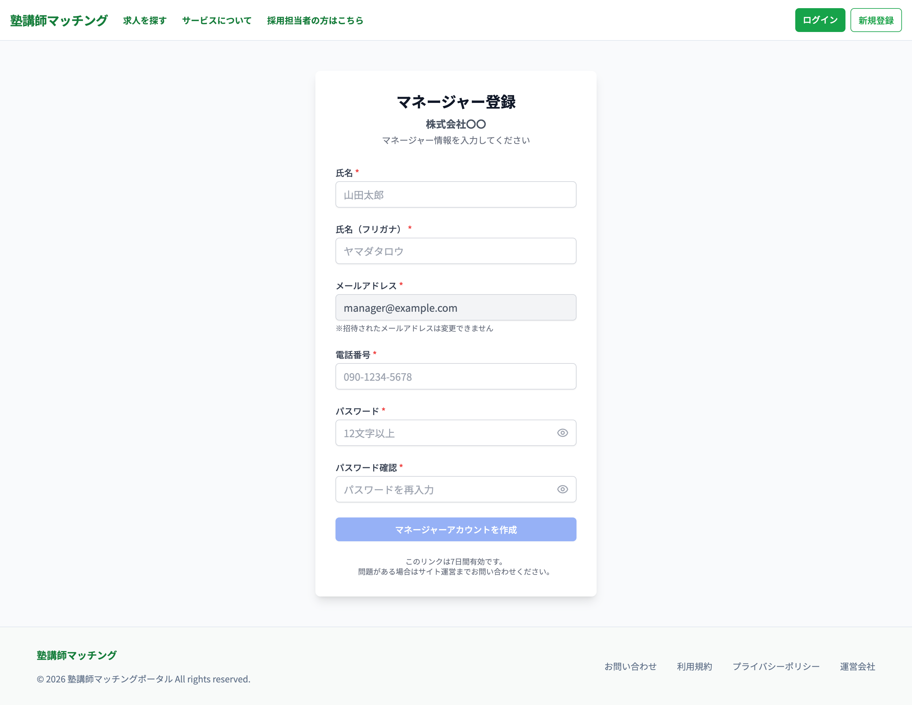

3. これで登録は完了です。

## 利用停止の流れ
- 利用停止手続きの申請はサイトを通して行わず、メール: support@juku-match.jp までお願いします。
- 利用停止を申請してから利用停止処理が完了するまで、1ヶ月ほどの時間を要す場合があります。
- 利用停止処理中であっても、採用やみなし採用の請求は通常通り発生します。

1. サイト運営者にメールで申請をする。

2. サイト運営者が処理を開始した後、3日間の待機期間があります。

3. 待機期間後、最初の処理が行われます。
    - 新規校舎の作成ができなくなります。
    - 全ての求人がアーカイブされます。
    - 新規求人を作成できなくなります。

4. 採用プロセスが終了するまで、待機します。
    - まだ完了していない採用プロセスは、最後まで続けることができます。
    - 採用プロセスに関する機能（応募者とのメッセージなど）は変わらずご利用できます。

5. すべての採用プロセスが終了すると、7日間の待機期間には入ります。
    - 採用確定後に連絡が取れなくなることを防ぐための期間です。
    - この期間が過ぎた後は、応募者と連絡を取ることはできません。
  
6. 待機期間後、会社の利用停止処理が完了となります。

## 採用担当者アカウント登録
1. マネージャーが招待を作成すると、招待メールが届きます。
    - マネージャによる招待作成方法は[こちら](#採用担当者の追加)

2. 送信されたメールのURLにアクセスし、フォームに入力し作成します。
    - メールアドレスは招待を受信したものから変更できません。
    - 変更したい場合は、サインイン後プロフィール編集ページから行えます。
    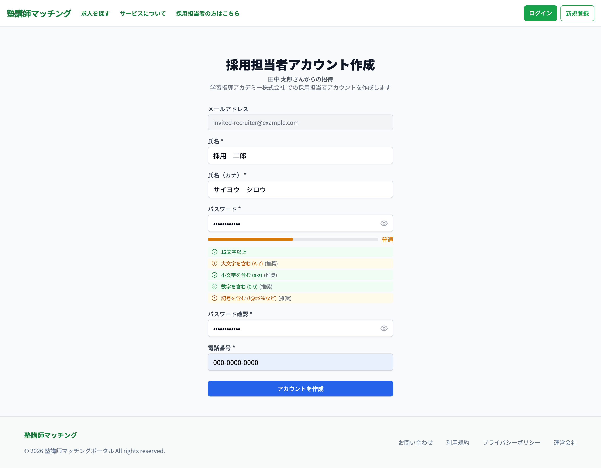

3. マネージャーが招待後の承認を求めるように設定している場合、承認されるまでは、ログインしても待機画面へ遷移されます。
    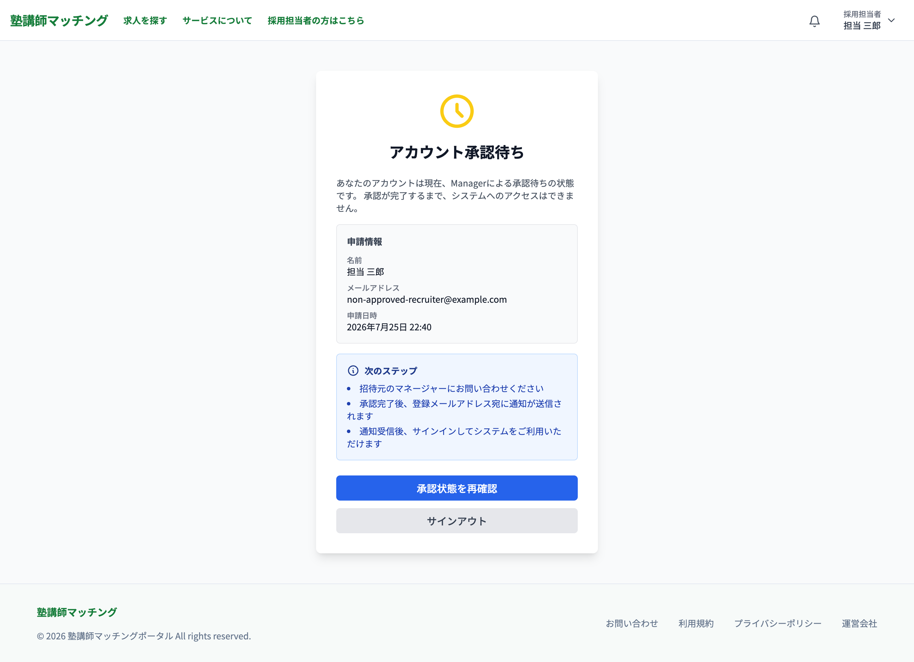
  
4. マネージャーに承認されると、採用担当者としての機能が利用できる様になります。

## 一般の採用担当者ができること
### ログイン
1. ヘッダーより「**ログイン**」ページへ。
    - 画像はトップページのものです。
    - 他のページでも共通で、ヘッダーがサイト最上部に表示されます。
    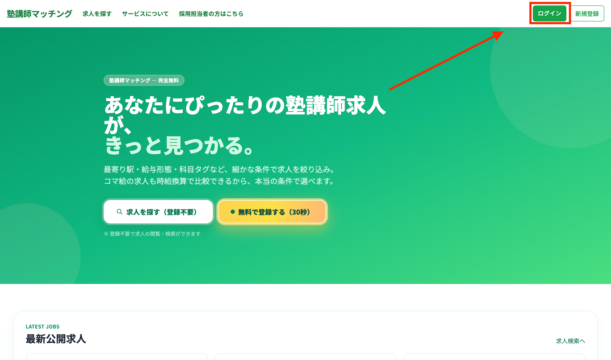

2. 「**求職者ログイン**」ページから「**採用担当者ログイン**」ページへ
    - 「ログイン」ボタンを押して開くページは、**求職者向け** です。
    - ここにメールアドレスとパスワードを入力しても、ログインすることはできません。
    - 「採用担当者はこちら」の「こちら」をクリックしてください。
    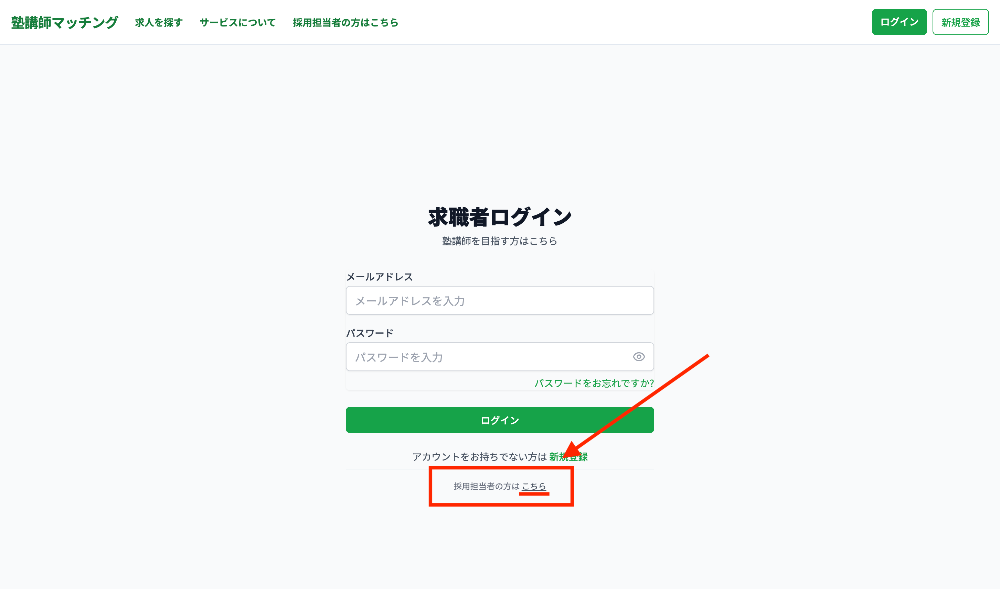

3. 「**採用担当者ログイン**」ページにメールアドレスとパスワードを入力してログイン
    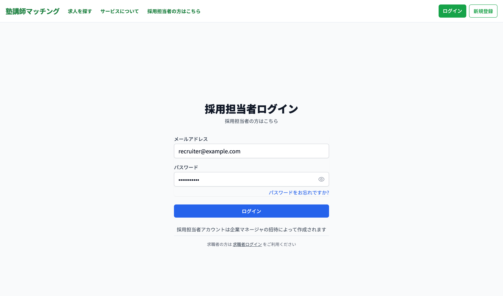

4. (2段階認証設定がオンの場合のみ) ログインを押すと2段階認証の6桁のコードを入力し認証
    - 設定がオフの場合は、このページには到達せず、ログインを完了することができます。
    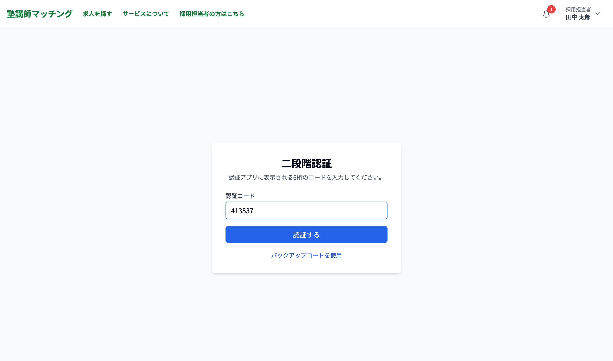

5. ログイン完了でダッシュボードのページへ
    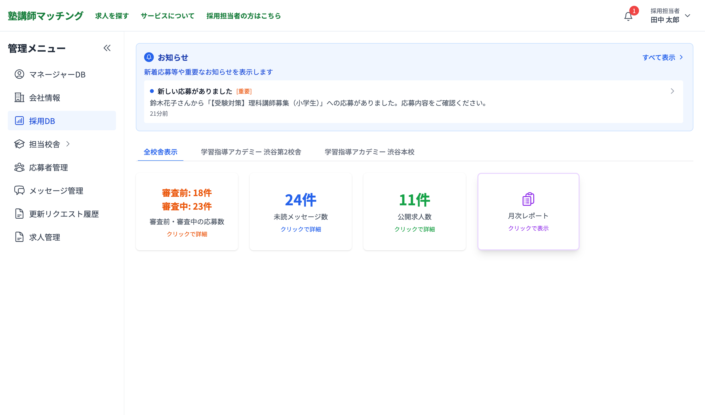

- [https://www.juku-match.jp/auth/recruiter/signin](https://www.juku-match.jp/auth/recruiter/signin) をブラウザのブックマーク等で登録しておき、ワンクリックでログインページに辿り着けるようにしておくこともおすすめです。

### 更新リクエスト履歴の確認
- サイドバー→更新リクエスト履歴より、自分の作成した更新リクエストとその審査結果の一覧を閲覧できます。
- 会社、校舎、求人すべてが同じリストに表示されます。
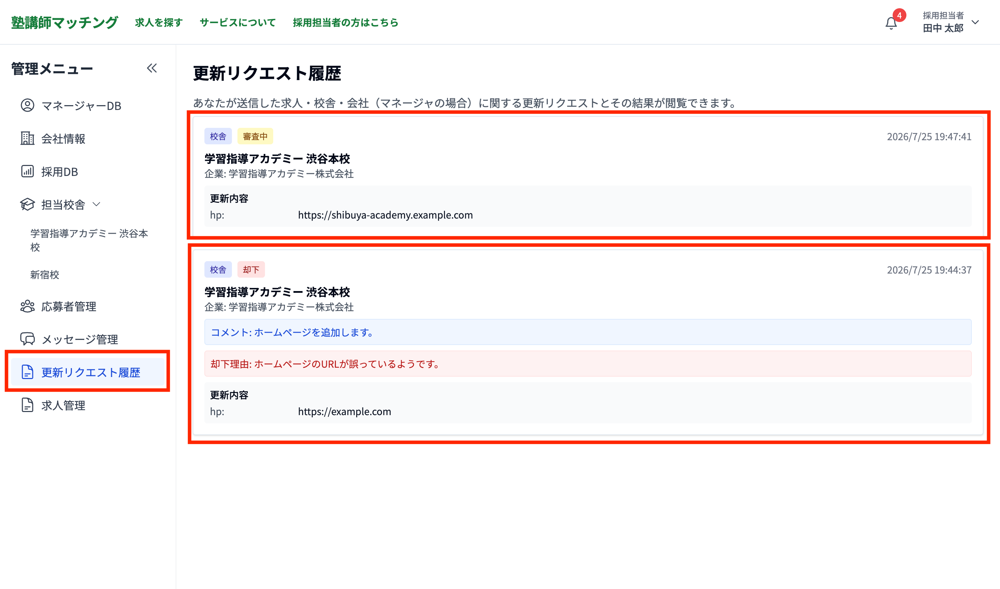

### 通知・メール(リクルーター)
次の項目の通知を受信できます。緊急度の高いものは設定によらず送信されることがあります。
- 設定でオフにもできるもの
    - 新規応募受信時
    - 採用ステータス確定期限10日前(応募50日後)(注意の通知)
    - 採用ステータス確定期限超過時(応募60日後)
    - 応募者がBANされ、採用プロセスが強制終了となった時
    - 応募者からのメッセージ受信時
    - 求人、校舎の新規作成または更新の審査結果
    - デイリーサマリー：メールのみの送信
    - 運営からのお知らせ
- 設定によらず送信されるもの
    - アカウントに関するもの
    - 校舎割り当てが変更された時
    - 校舎のアーカイブに関する連絡
    - 会社のアーカイブに関する連絡
    - 求人の規制に関する連絡
    - 校舎の規制に関する連絡
    - 会社の規制に関する連絡

通知の設定：ヘッダー右上→ドロップダウン→「設定・履歴」→「通知設定」

### プロフィール設定
- 設定・履歴→プロフィールから、氏名・電話番号・メールアドレスの変更ができます。
- メールアドレスの変更には、メールアドレスの認証が必要です。

### 2段階認証設定(強く推奨)
- 設定・履歴→2段階認証から、2段階認証の設定ができます。
- 「Google Authenticator」や「パスワード(iOS)」などの認証アプリで利用できます。
- 2faを登録すると、次回以降のログインでワンタイムパスコードを求められます。入力することでログインが完了します。
- 無効化も同じページから可能です。

### ログイン履歴・各種操作の履歴
- 設定・履歴→ログイン履歴から、自分のアカウントのログイン履歴が確認できます。
- 設定・履歴→監査ログから、自分のアカウントの操作履歴が確認できます。

### パスワードを忘れた場合
1. ログイン画面→「パスワードをお忘れですか」をクリック。

2. 遷移したページで登録のメールアドレスを入力し、メールでパスワード変更用ページのURLを受け取る。

3. 新しいパスワードを入力し、パスワードを変更。

4. メールアドレスと新しいパスワードで、ログイン。

## マネージャーができること(会社管理)
### マネージャーDB
- **ダッシュボード**のことを**DB**と略記しています。
- **採用DB(担当校舎管理)** と **マネージャーDB(会社総括管理)** を混同しないようご注意ください。
- マネージャー限定機能は基本的にマネージャーDBに集約されています。
- マネージャーDBには、「統計」「校舎管理」「メンバー」「請求」「その他」の五つのタブがあり、それぞれに応じた機能が提供されています。
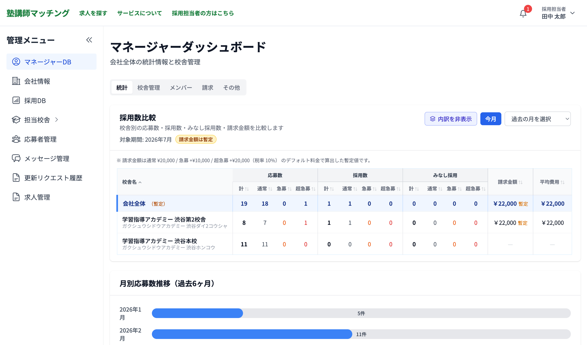 

### 校舎
#### 新規校舎作成
1. マネージャーダッシュボード→校舎管理→新規校舎作成ボタンをクリック。
    - 採用DBではなく **マネージャーDB**です。ご注意ください。
  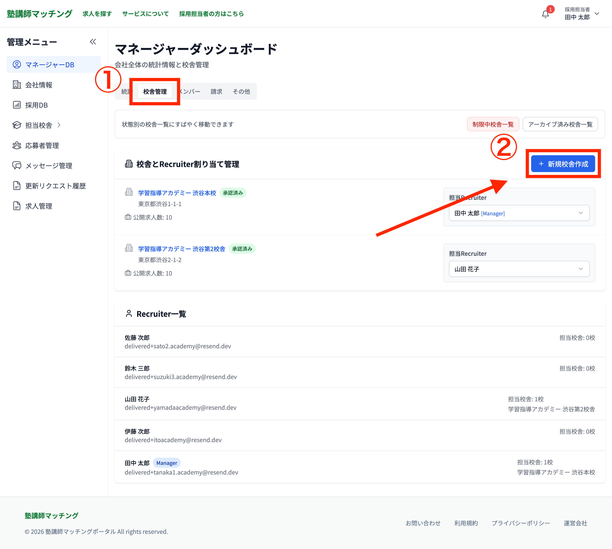

2. 校舎新規作成ページのフォームに校舎の情報を入力し作成。
  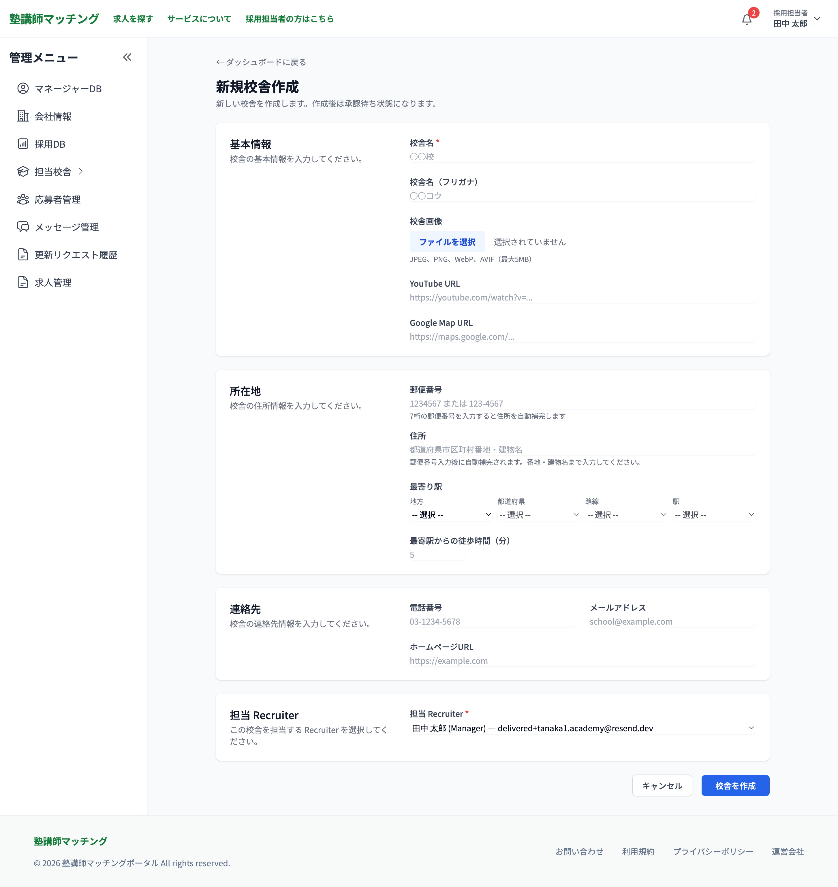

3. サイト運営者による新規校舎の審査を待ちます。
    - 審査には数日かかる場合があります。  
    - 審査待ちの間は、求人作成等の機能は利用できません。
    - 審査待ちの間に新規校舎の申請データを変更することができます。

4. 審査が終わると、審査結果が割り当てられている採用担当者に通知されます。

##### 承認された場合
    - 校舎の詳細ページが一般公開されます。
    - 求人作成および公開などの機能も使える様になります。割り当てられている採用担当者に承認のことが通知されます。

##### 却下された場合
    - 割り当てられている採用担当者に却下されこととその理由が通知されます。
    - 却下理由を踏まえ、再度校舎情報を更新してください。

##### 却下に対する更新方法
  1. マネージャーダッシュボード→校舎管理→校舎名をクリック。
    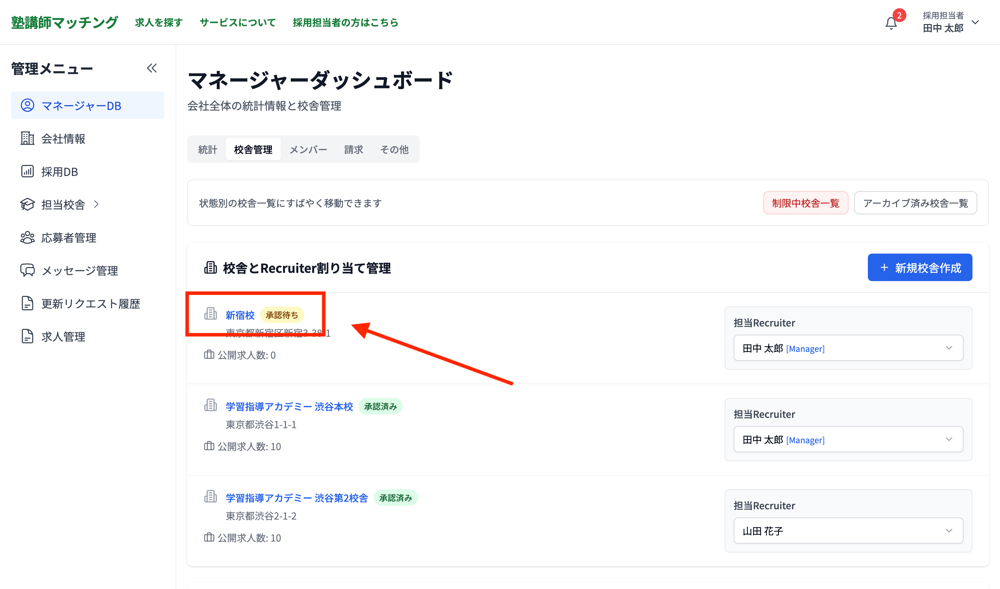

  2. 校舎詳細ページで却下理由を確認し、編集ページへ移動する。
    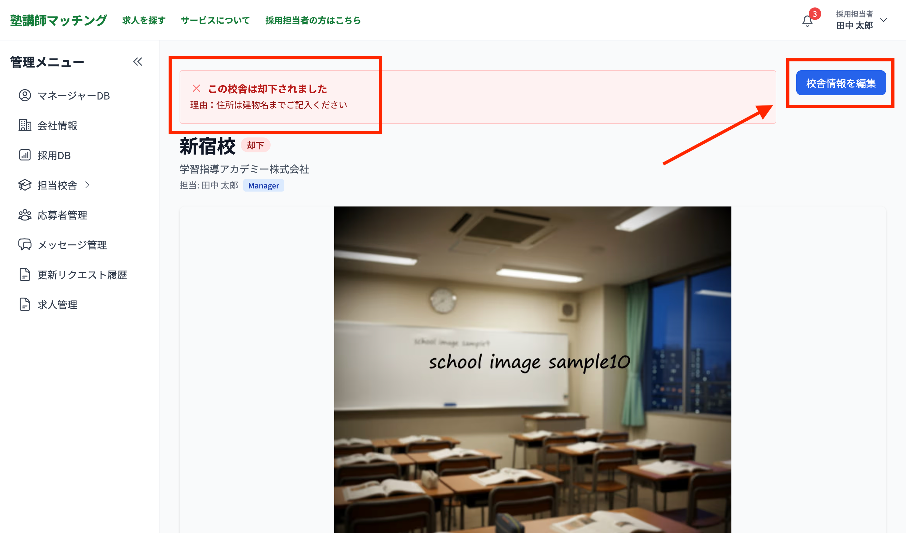

  3. フォームでデータを修正し送信する。
    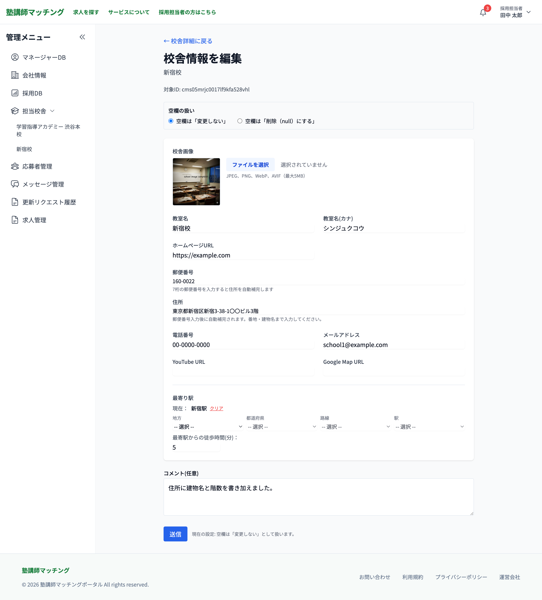

  4. 以後は[新規作成](#新規校舎作成) の3に戻ります。

#### 校舎更新リクエスト
- 更新リクエストとは、**校舎作成後すぐに行われる審査に承認された後** の更新に関するものです。
- 基本的な操作や流れは、[却下に対する更新方法](#却下に対する更新方法) と同様です。
0. マネージャーDB→校舎管理から校舎詳細ページを開く。

1. 詳細ページの「更新リクエストを作成」をクリック。
    - 審査中には「校舎情報を編集」のボタンが、承認後は「更新リクエストを作成」のボタンが表示されます。
  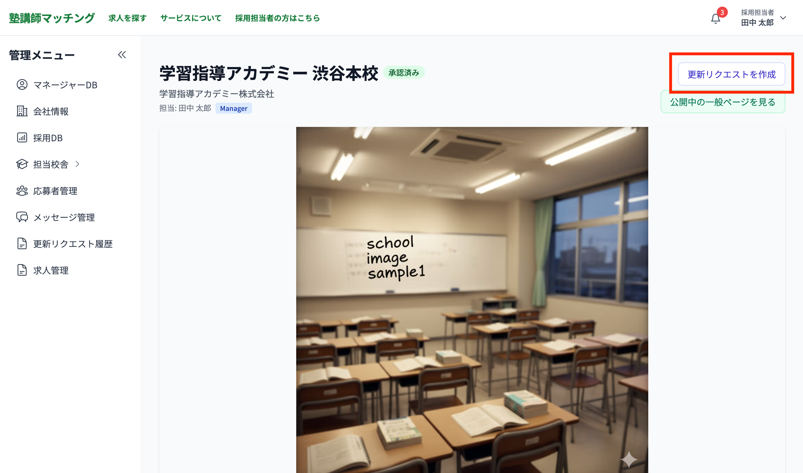

2. 更新リクエスト作成ページのフォームに校舎の情報を入力し作成。

3. サイト運営者による更新リクエストの審査を待ちます。
    - 審査には数日かかる場合があります。  
    - 更新リクエストの審査中は、全ての機能をそのまま利用できます。

4. 審査が終わると、更新リクエストを送信したユーザーに通知されます。
    - 承認されると、リクエストが公開データに反映されます。
    - 却下された場合は、却下理由を踏まえ、再度リクエストを作成してください。

### 採用担当者
#### 採用担当者の追加
1. マネージャーDB→メンバーを開き、採用担当者招待というフォームに招待相手のメールアドレスを入力し送信する。
    - 複数のメールアドレス宛に同時に招待を送信することもできます。
  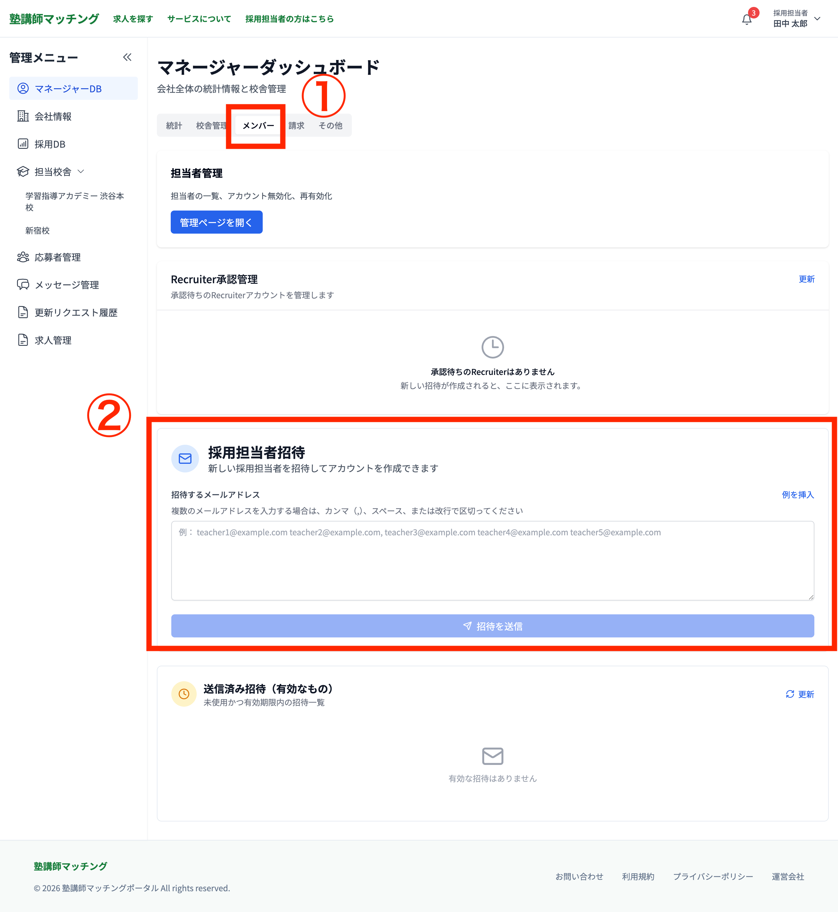
  
2. メールを受け取った採用担当者がアカウントを作成します。

3. (招待後の承認をオンに設定している場合、)
    - マネージャーDB→メンバー→担当者承認管理という項目があります。
    - 採用担当者が正しいことを確認し、承認ボタンを押すことで、対象の採用担当者を有効化することができます。
  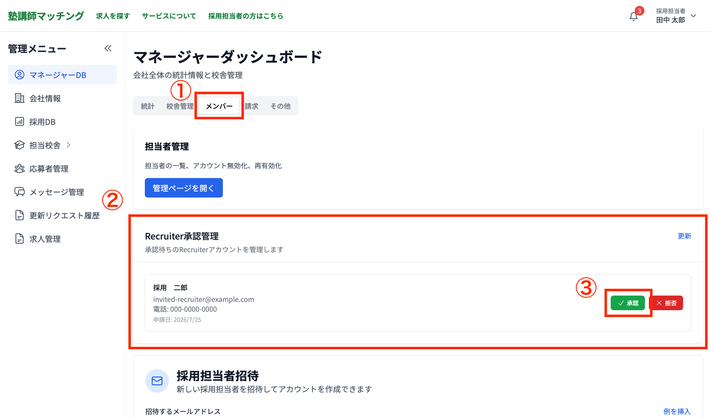

##### 新規作成担当者の承認可否設定
- マネージャーDBその他タブより設定可能です。
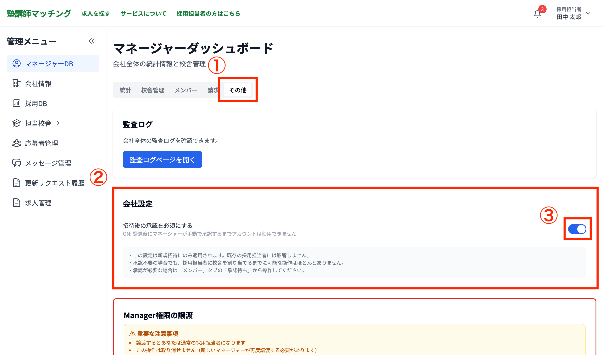

#### 採用担当者に対する校舎の割り当て
1. マネージャーDB→校舎管理→校舎とRecruiter割り当て変更を開く。

2. 採用担当者の名前の書かれたエリアを押すことで、会社内の採用担当者を選択することができます。

3. 選択された採用担当者に校舎が割り当てられます。

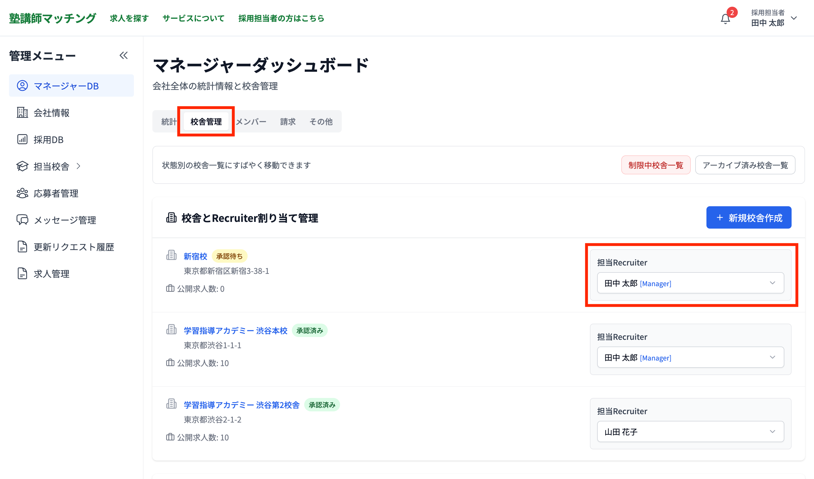

- 一つの校舎には常にちょうど一人の採用担当者のみを割り当てることができます。
- 複数人を同時に一つの校舎に割り当てることはできません。
- 複数校を兼任したり、マネージャーと兼任したりすることは可能です。

#### 採用担当者管理・無効化
1. マネージャーDB→メンバー→担当者管理→「管理ページを開く」をクリック。
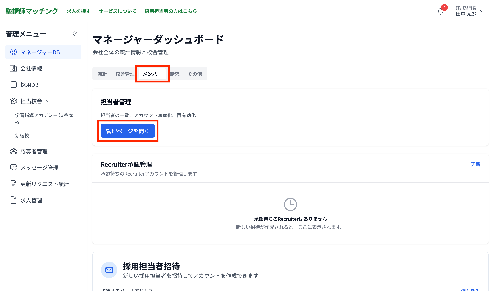

2. 採用担当者のリストが表示されます。
    - リストでは、氏名、メールアドレス、電話番号、Maneger権限、承認状態、2FA有効可否、担当校舎数、最終ログイン、状態(アクティブor無効化中) を閲覧できます。

3. リスト内右のボタンで無効化・再有効化が行えます。
    - 無効化できるのは、担当校舎がない採用担当者のみです。
    - 無効化した採用担当者は30日後に削除されます。
    - 無効化は、退職者などのデータを削除する際に用いてください。
    - 削除される前であれば、無効化した担当者を再度有効化することができます。
  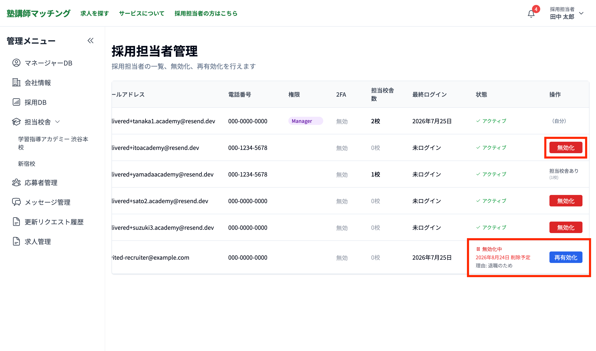

### 会社情報更新リクエスト
- 会社の情報も更新リクエストを作成することができます。
1. サイドバー→会社情報→更新リクエストを作成をクリック。
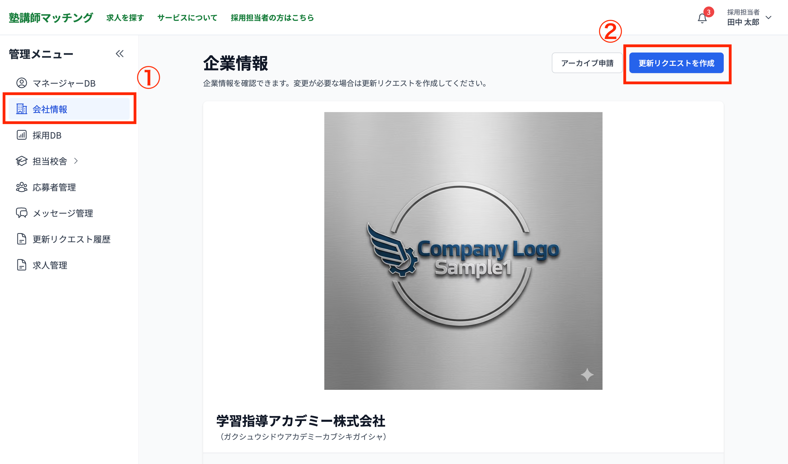

2. 以降の流れは[校舎に対する更新リクエスト](#校舎更新リクエスト) と同様です。

### マネージャー権限譲渡
1. マネージャーDB→その他→Manager権限の譲渡を開く。
  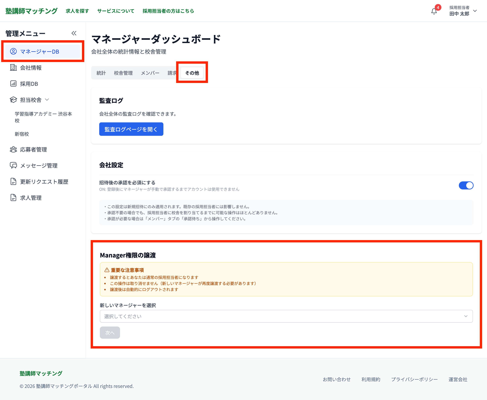

2. 新しいマネージャーを採用担当者の中から選択し、パスワードを入力すると、譲渡が確定されます。

3. 譲渡が確定すると、塾マッチより新・旧マネージャーにそれぞれメールが送信されます。

- 旧マネージャーは自動的にログアウトされ、再ログインが必要となります。
- 旧マネージャーは通常の採用担当者になり、採用担当者としての機能のみ引き続き利用できます。
- 新マネージャーはマネージャー権限を受け取り、マネージャーとしての機能が利用できる様になります。権限が反映されない場合は、ログアウトしログインし直すことで反映されます。
- **権限の譲渡はすぐに反映され、取り消すことができません。権限を戻すには新マネージャーから旧マネージャーに譲渡する必要があります。**

### 請求書
- 毎月10日請求書が発行され、マネージャー宛にメールで送信されます。
- 請求書は、サイトからも確認することができます。

1. マネージャーDB→請求を開く。
  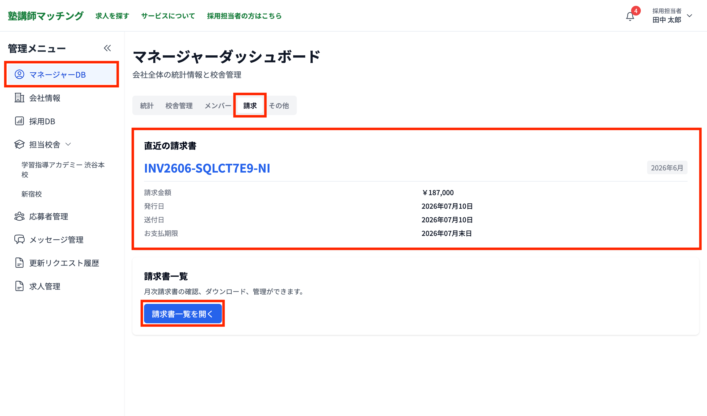

2. 直近の請求書の青色の請求番号をクリックすると、その詳細ページが開きます。(4へ進む)

3. 「請求書一覧を開く」を押すと、過去の請求書の一覧を確認できます。
    - 表中の請求番号をクリックすると請求書の詳細ページが開きます。
    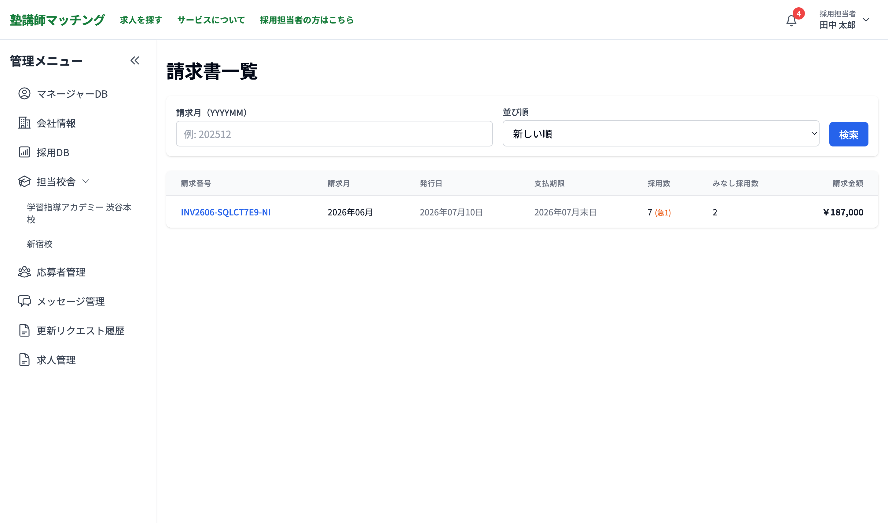

4. 詳細ページでは、詳細の閲覧ができます。
    - 「PDFプレビュー」を押すと、PDFの形で閲覧することができます。
    - 「PDFダウンロード」を押すと、PDFをダウンロードができます。
    - 「採用者一覧」を押すと、請求の個別の情報のリストが確認できます。
    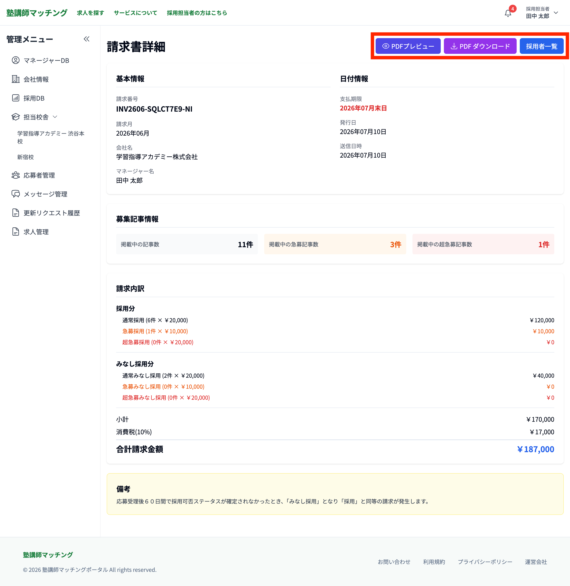

### 通知・メール(マネージャー)
次の項目の通知を受信できます。緊急度の高いものは設定によらず送信されることがあります。
- 設定でオフにもできるもの
    - 会社の更新の審査結果
    - 招待したリクルーターが登録した時
    - 運営からのお知らせ
- 設定によらず送信されるもの
    - 請求に関するもの
    - マネージャー権限に関するもの 
    - アーカイブに関するもの
    - 規制に関するもの

通知の設定：ヘッダー右上→ドロップダウン→「設定・履歴」→「通知設定」

### その他
- マネージャーDB→統計では、統計情報を閲覧することができます。
- マネージャーDB→その他→「監査ログページを開く」で、採用担当者の主要操作の記録を閲覧することができます。

## 担当校舎に関してできること(校舎管理)
採用担当者はマネージャーにより割り当てられた校舎のみを対象として様々なことができます。

### 採用担当者のダッシュボードについて
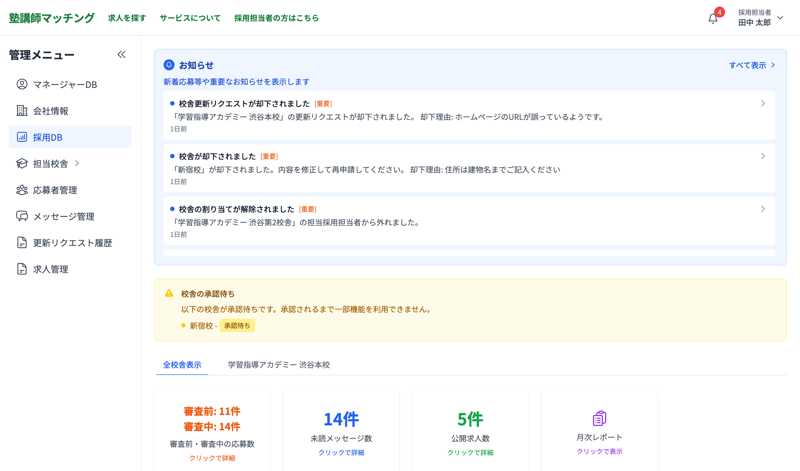
- 採用担当者のダッシュボードでは、校舎管理に関する機能が集約されています。
- ダッシュボードのことを、採用DBやDBと表記することがあります。
#### 1. 通知ウィジェット
- 新着順に通知の一覧が見られます。
- クリックで通知の詳細ページを開くことができます。
- 「すべて表示」を押すことで、通知一覧ページを開くことができます。
#### 2. 承認待ちの情報
- 自分の担当校舎の中に承認待ちのものがある場合のみ表示されます。
#### 3. 採用総合パネル
- 校舎選択ボタンタブ:   
    - 「全校舎」を選択した場合、「統計カード」と「詳細表示」は自分が担当する校舎を合計したデータが表示されます。
    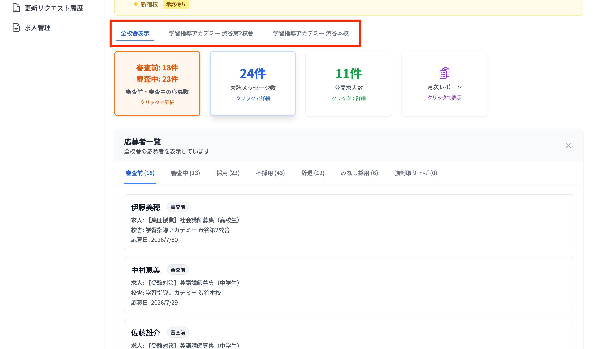
    - 「〇〇校(各担当校舎)」を選択した場合、「統計カード」と「詳細表示」は選択している校舎のみのデータが表示されます。
    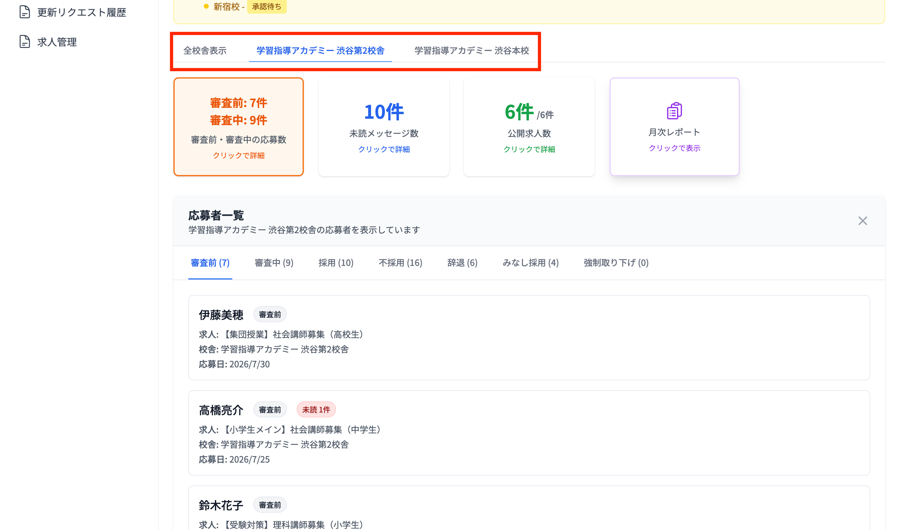
- 統計カード:  
四つの統計カードがあります。統計カードをクリックすると、そのカードに対応する詳細情報が下に展開されます。展開される内容は次のとおりです。
    - 応募カードに対して、応募者一覧。フィルタ機能あり。クリックで応募詳細ページへ。
    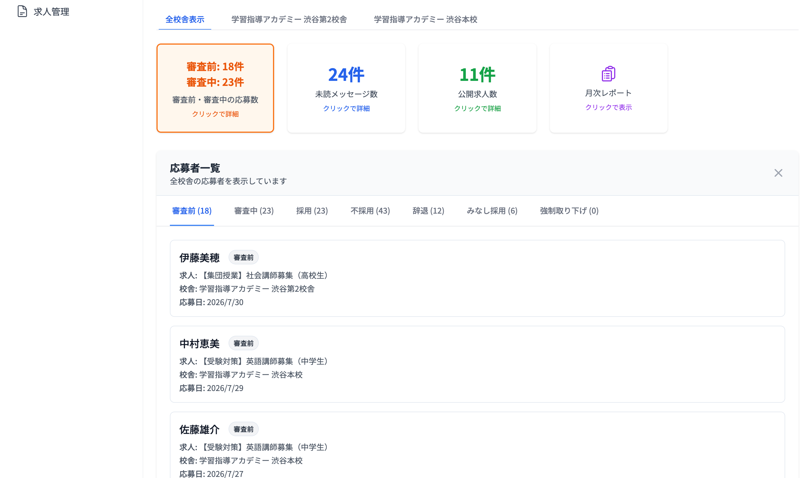
    - メッセージカードに対して、メッセージ一覧。フィルタ機能あり。クリックで応募詳細ページへ。(メッセージ機能は応募詳細ページの中にあります。)
    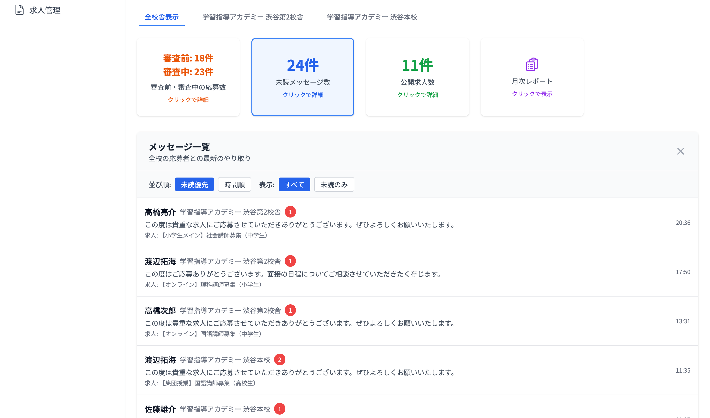
    - 求人カードに対して、求人一覧。フィルタ機能あり。クリックで求人詳細へ。
    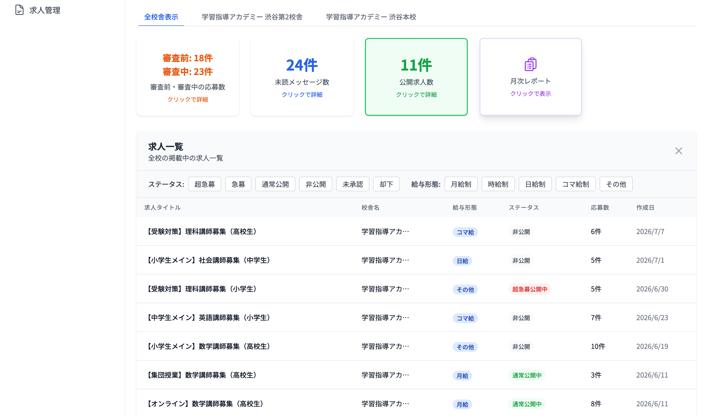
    - 月次レポートカードに対して、月次レポート。年月選択で過去のレポートも確認できます。
    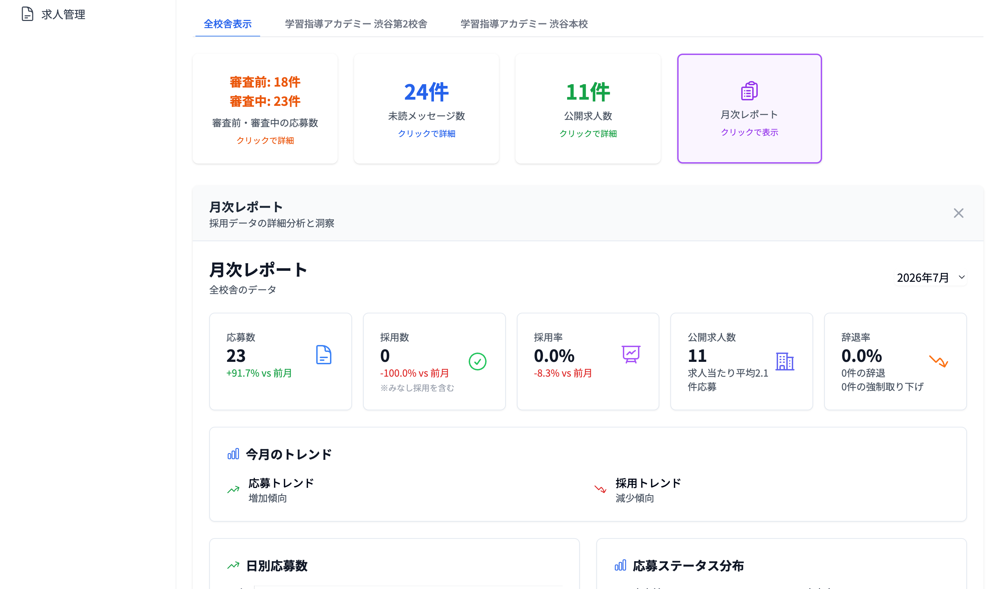

### 求人
- 求人を各校舎毎に6件まで**公開**することができます。
- 非公開のものは何件でも作成できます。

#### 新規求人作成
1. 求人新規作成ページを開きます。
    - 求人新規作成ページは、次のような方法で開くことができます。
        - 採用DB→求人カードをクリック→求人一覧の最下部の「求人新規作成」
        - サイドバー「求人管理」→右上「新しい求人を作成」

2. 必要事項を記入し送信することで求人が作成できます。
    - この時点では審査待ちの状態となり、求人はまだ公開されません。
    - 画面右上「既存求人をコピー」より、作成済みの求人のコピーをベースとして作成することができます。

3. サイト運営者が新規校舎情報を審査します。
    - 審査には、数日かかる場合があります。

##### 承認された場合 
- 求人を公開することができるようになります。
- 担当の採用担当者に承認のことが通知されます。

##### 却下された場合  
- 担当の採用担当者に却下されこととその理由が通知されます。
- その理由を踏まえ、求人を修正してください。

##### 却下に対する更新方法(求人)
1. 求人詳細ページを開く。

2. 「直接編集して再申請」をクリックし、編集ページを開く。
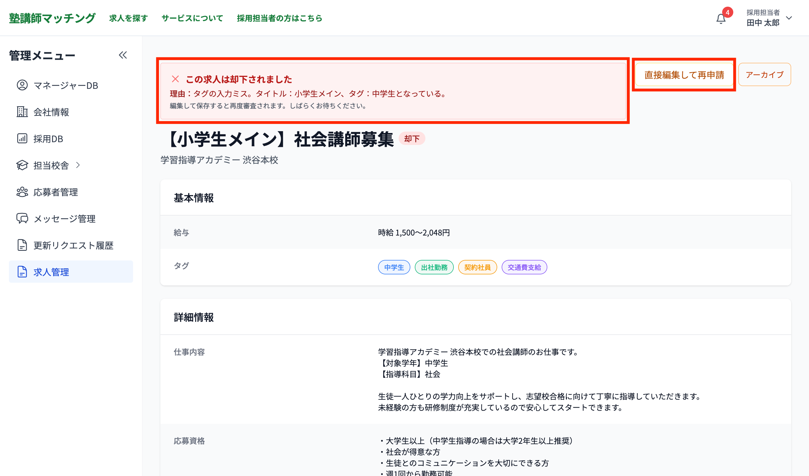

3. フォームでデータを修正し送信する。

4. 以後は[新規求人作成](#新規求人作成) の3に戻ります。

#### 求人更新リクエスト
- **審査承認後**に、求人情報を更新する場合は、更新リクエストを通して行います。
- 基本的な操作や流れは、[却下に対する更新方法](#却下に対する更新方法(求人)) と同様です。

1. 求人詳細ページを開く。

2. 「更新リクエストを作成」をクリックし、編集ページを開く。
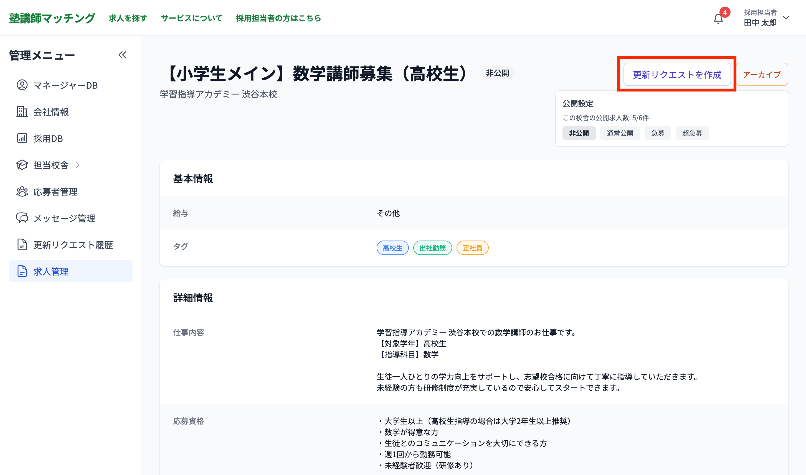

3. フォームでデータを修正し送信する。

4. サイト運営者による更新リクエストの審査を待ちます。
    - 審査には数日かかる場合があります。  
    - 更新リクエストの審査待ちの間は、全ての機能をそのまま利用できます。
    - 求人を公開設定にしている場合は、リクエスト前のデータのまま公開されます。

5. 審査が終わると、更新リクエストを送信したユーザーに通知されます。
    - 承認されると、リクエストが公開データに反映されます。
    - 却下された場合は、却下理由を踏まえ、再度リクエストを作成してください。

#### 公開フラグ 急募フラグの更新
- 承認済みの求人を、非公開/通常公開/急募/超急募 の中から設定することができます。
    - 非公開：求人の一般公開が停止されます。会社内の担当者にのみ表示されます。
    - 通常公開：求人が一般公開されます。サイトに訪れる求職者に閲覧されます。
    - 急募：求人が急募として優先的に一般公開されます。
    - 超急募：求人が超急募としてさらに優先的に一般公開されます。
- 承認済みであれば、いつでも自由に **審査なし** で更新することができます。

1. 求人詳細ページを開きます。

2. 右上の公開設定で、「非公開」<->「公開」<->「急募」<->「超急募」の切り替えができます。
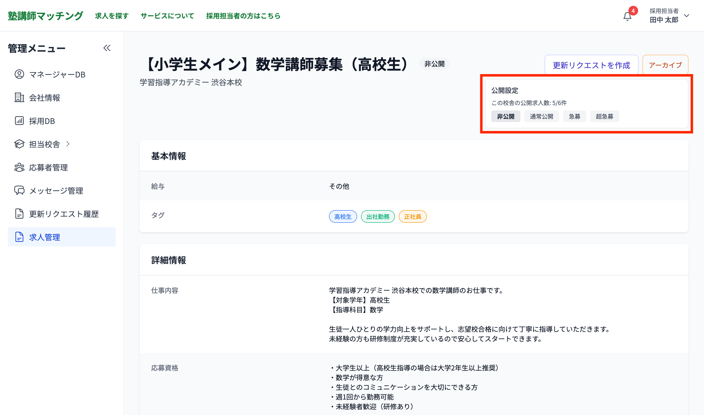

#### 求人アーカイブ
- アーカイブとは、使う予定のなくなった求人を破棄するための機能です。
- アーカイブすると、
    - 求人は永続的に非公開となります。
    - 復元および編集はできません。
    - 担当者のみアーカイブ済み求人を閲覧することができます。
    - 求人に対する応募は維持され、応募者とのメッセージなどは変わらずご利用できます。

1. 求人詳細ページ右上の「アーカイブ」を押します。

2. 注意を読んで、「アーカイブ実行」を押します。

### 応募・採用プロセス
求職者からの応募があると、採用プロセスが開始され、応募詳細ページが作成されます。応募者一覧やメッセージ一覧から開くことができます。

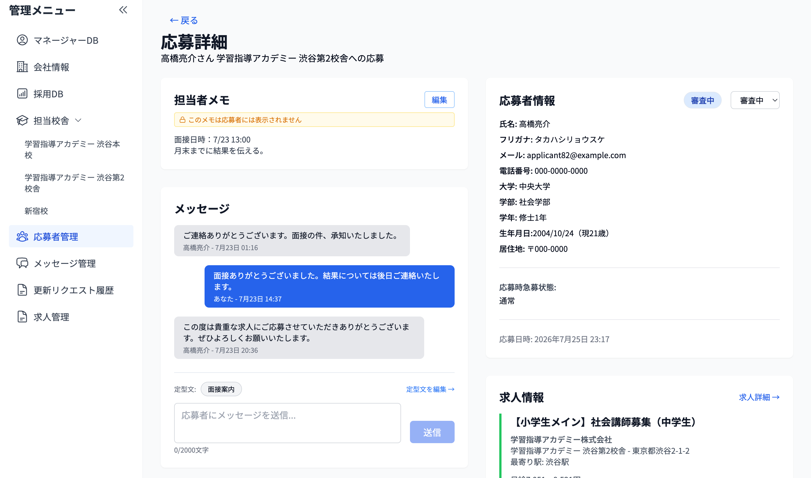

- 応募詳細ページには次のような機能があります。
    - 担当者メモ
    - 応募者と採用担当者の間のメッセージのやり取り
    - 採用状況ステータスの変更
    - 応募者情報、求人情報の閲覧

#### 担当者メモ
- メモは採用担当者だけが閲覧できます。

#### メッセージ
- チャットアプリのような形式で、応募者とメッセージを送受信することができます。
- 画像などのファイルの送受信の機能は提供されていません。
- ステータス確定後1週間経過してからは、メッセージの送受信ができません。
    - ステータス確定とは、採用/不採用/辞退/みなし採用のいずれかになることを指します。
- メッセージの定型分を三件登録し、利用することができます。

#### 採用状況ステータス
- 採用状況ステータスとは、審査前/審査中/採用/不採用/辞退/みなし採用/強制取り下げ のいずれかのことを言います。
- 採用担当者が変更できるのは、次の表の通りです。  

    | 変更前         | ---------->     | 変更後       |
    | -------------- | --------------- | ------------ |
    | 審査前         | ----------->    | 審査中       |
    | 審査前or審査中 | -**課金発生**-> | 採用         |
    | 審査前or審査中 | ----------->    | 不採用or辞退 |

- ステータスを進めたら **戻すことはできません**。ご注意ください。

- 採用担当者は求職者の応募から60日以内に採用可否を確定する必要があります。
    - 応募60日後のステータスが審査前/審査中である場合、システムで自動的に「みなし採用」となります。「みなし採用」になると、採用と同様の課金が発生します。  
    
    | 変更前         | ---**60日**---->  | 変更後     |
    | -------------- | ----------------- | ---------- |
    | 審査前or審査中 | --**課金発生**--> | みなし採用 |

    - 「みなし採用」は採否報告の許容期間の超過を意味するステータスであり、選考プロセスそのものを強制的に終了させるものではありません。選考プロセスが継続中の場合は、引き続き採用担当者とのやり取りを続けることができます。

#### 応募者情報
- 応募者の個人情報の一部は、「不採用」「辞退」確定14日後以降は非表示になります。

### 担当校舎
- 採用担当者は、割り当てられている校舎の情報を更新をすることができます。
- **新規校舎の作成はできません。** マネージャーによる作成、割り当てが必要です。

#### 審査通過前の校舎の編集 
マネージャーによる新規作成後、審査通過前の校舎の更新に関するものです。

1. 担当者向け校舎詳細ページを開きます。
    - サイドバー→担当校舎
  などから開くことができます。

2. 詳細ページの「校舎情報を編集」をクリックし、ページを開く。

3. フォームでデータを修正し送信する。
    
4. サイト運営者による審査を待ちます。
    - 審査には数日かかる場合があります。  
    - 審査待ちの間は、求人作成等の機能は利用できません。
    - 審査待ちの間に新規校舎の申請データを変更することができます。

5. 審査が終わると、審査結果が割り当てられている採用担当者に通知されます。

### 審査通過後の校舎の更新リクエスト
更新リクエストとは、**承認済み** の校舎の更新に関するものです。基本的な操作や流れは、[審査通過後の校舎の編集](#審査通過前の校舎の編集) と同様です。

1. 担当者向け校舎詳細ページを開きます。
    - サイドバー→担当校舎などから開くことができます。

2. 詳細ページの「更新リクエストを作成」をクリック。

3. 更新リクエスト作成ページのフォームに校舎の情報を入力し作成。

3. サイト運営者による更新リクエストの審査を待ちます。
    - 審査には数日かかる場合があります。  
    - 更新リクエストの審査中は、全ての機能をそのまま利用できます。

4. 審査が終わると、更新リクエストを送信したユーザーに通知されます。
    - 承認されると、リクエストが公開データに反映されます。
    - 却下された場合は、却下理由を踏まえ、再度リクエストを作成してください。

#### 校舎のアーカイブ
担当校舎単位で塾マッチの利用を停止する場合、校舎をアーカイブすることができます。

校舎がアーカイブされると次のようになります。
- 校舎とその求人は非公開となります。
- 校舎に関する全ての機能が利用できなくなります。
- マネージャーに限り、アーカイブされた校舎情報を閲覧することができます。
- アーカイブされた校舎およびその求人を、編集したり復元したりすることはできません。
- アーカイブ処理中であっても採用やみなし採用の請求は通常通り発生します。

1. 校舎詳細ページから「アーカイブ申請」をクリック。

2. 3日間の待機期間があります。
    - 待機期間の間はキャンセルすることができます。

3. 待機期間の後、求人が全てアーカイブされ、新規求人作成ができなくなります。

4. 採用プロセスが終了するまでの待機期間があります。
    - この期間は、進行中の採用プロセスを最後まで完了させるためにあります。
    - 応募者とのメッセージなどの機能は変わらず利用できます。
    - 求人作成、公開などの機能は利用できません。

5. すべての採用プロセスが終了してから7日間の待機期間があります。
    - この期間は、採用した応募者との連絡手段を途絶えさせないためにあります。
    - 待機期間が終わるまでに、採用した応募者との連絡手段をこのサイト外部で確保してください。

6. 校舎のアーカイブ処理が完了されます。

## 和英対応表
サイト内や資料中で、同一概念に対する異なる表記を含む場合がありますが、その対応は次の表の通りです。  

| 英語名        | 和名               |
| ------------- | ------------------ |
| Company       | 会社, 企業         |
| School        | 校舎               |
| Recruiter     | 採用担当者         |
| Manager       | マネージャ         |
| assign        | 割り当て, 担当     |
| Job           | 求人               |
| UpdateRequest | 更新リクエスト     |
| Application   | 応募、採用プロセス |